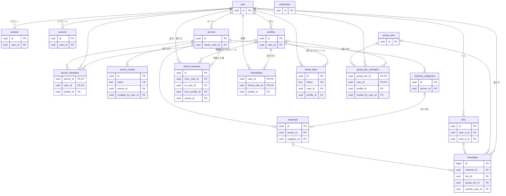

# データモデル（schema）

DB（Neon の Postgres）のテーブルの一覧と、テーブルにまたがる規則。テーブルごとの詳細は `schema/` に 1 テーブル 1 ファイルで置く。画面と API のパスは [routes.md](routes.md)・[uri.md](uri.md) にある。

## ER 図
関係とキーだけを書く。列の詳細は各テーブルのファイルにある。



## テーブルの一覧
| テーブル | 内容 | 状態 |
|----------|------|------|
| [`user`](schema/user.md) | アカウント（Better Auth） | 予定（GT-000003） |
| [`session`](schema/session.md) | ログインのセッション（Better Auth） | 予定（GT-000003） |
| [`account`](schema/account.md) | ログインの方法とパスワード（Better Auth） | 予定（GT-000003） |
| [`verification`](schema/verification.md) | 確認用のトークン（Better Auth。MVP では使わない） | 予定（GT-000003） |
| [`profiles`](schema/profiles.md) | プロフィール | 予定（GT-000003） |
| [`servers`](schema/servers.md) | サーバー | 予定（GT-000009） |
| [`server_members`](schema/server_members.md) | サーバーのメンバーと、サーバーで使うプロフィール | 予定（GT-000009） |
| [`server_invites`](schema/server_invites.md) | サーバーの招待リンク | 予定（GT-000009） |
| [`channels`](schema/channels.md) | チャンネル | 予定（GT-000011） |
| [`channel_categories`](schema/channel_categories.md) | チャンネルのカテゴリ | 予定（GT-000012） |
| [`friend_requests`](schema/friend_requests.md) | フレンド申請 | 予定（GT-000015） |
| [`friendships`](schema/friendships.md) | フレンドと、相手に見せるプロフィール | 予定（GT-000015） |
| [`friend_links`](schema/friend_links.md) | フレンドリンク | 予定（GT-000016） |
| [`dms`](schema/dms.md) | DM | 予定（GT-000017） |
| [`group_dms`](schema/group_dms.md) | グループ DM | 予定（GT-000018） |
| [`group_dm_members`](schema/group_dm_members.md) | グループ DM の招待・メンバーと、グループ DM で使うプロフィール | 予定（GT-000018） |
| [`messages`](schema/messages.md) | メッセージ（チャンネル・DM・グループ DM） | 予定（GT-000014） |

## ドメイン概念とテーブル
[overview.md](overview.md) の概念が、どのテーブルで表されるか。

| 概念 | テーブル |
|------|----------|
| アカウント | `user`（ログインは `session`・`account`） |
| プロフィール | `profiles`（デフォルトは `is_default`） |
| サーバー | `servers`（オーナーは `owner_user_id`） |
| サーバーのメンバー | `server_members` |
| 招待リンク | `server_invites` |
| チャンネル・カテゴリ | `channels`（既定のチャンネルは `is_default`）・`channel_categories` |
| フレンド申請 | `friend_requests` |
| フレンド | `friendships`（1 組を向きごとに 2 行） |
| フレンドリンク | `friend_links` |
| DM | `dms` |
| グループ DM | `group_dms`・`group_dm_members` |
| メッセージ | `messages` |
| 相手ごとのプロフィールの割り当て | 専用のテーブルは無い。使う場所ごとの列で表す（下の「プロフィールの割り当て」） |

## プロフィールの割り当て
「その場で、相手にどのプロフィールを見せるか」は、次の 3 つの列で表す。

| その場 | 列 | 備考 |
|--------|----|------|
| サーバー | `server_members.profile_id` | そのサーバーのメンバー全員に見せる |
| フレンド・DM | `friendships.profile_id` | その相手だけに見せる。DM もこれを使う |
| グループ DM | `group_dm_members.profile_id` | そのグループ DM のメンバー全員に見せる |

- プロフィールが「使用中」とは、上のどれかで割り当てられていること。サーバーは `left_at` が null の行、グループ DM は `status = 'joined'` の行だけを数える（退出した行の `profile_id` は「直前のプロフィール」で、使用中ではない）。
- プロフィールの使用先の一覧は、この 3 つを合わせたもの。新しく割り当ての場を作るチケットは、この表に足す。

## 命名と型の規則
- テーブル名・列名は snake_case。自前のテーブルは複数形にする。Better Auth のテーブルは Better Auth の名前のまま（`user`・`session`・`account`・`verification`）。
- API の応答では camelCase に変える（`created_at` → `createdAt`）。
- 型は Postgres の型で書く（`uuid`・`varchar(n)`・`text`・`boolean`・`integer`・`bigint`・`timestamptz`）。
- 日時はすべて `timestamptz`。`created_at` は既定値 `now()`。
- 外部キーの列は `<参照先の単数形>_id`（例：`server_id`）。同じテーブルを 2 つ参照するときは役割を付ける（例：`from_user_id`・`to_user_id`）。
- 論理削除は `deleted_at`（null なら削除されていない）。論理削除した行は、一覧・取得・上限の数の対象から外す。

## id の規則
- URL や API の応答に出る id（アカウント・プロフィール・サーバー・チャンネル・DM・グループ DM）は UUID。アカウントの id は、Better Auth の id の生成を UUID にする設定で作る。
- メッセージの id は `bigint` の連番（ページ単位の取得で境目に使うため）。連番は推測しやすいので、下の「参加者の確認」を必ず行う。
- 招待リンク・フレンドリンクは、id とは別の推測できないランダムなトークン（`token`。暗号論的な乱数で 32 バイト以上を base64url にしたもの）を URL に使う。id は URL に出さない。

## 相手に見せてよいもの・見せてはいけないもの
- **ほかのアカウントに見せない**
  - アカウントの id（`user.id`）・メールアドレス・`user.name`
  - セッション・パスワード（`session`・`account`）
  - その人のほかのプロフィール、2 つのプロフィールが同じ人のものであること
- **ほかのアカウントに見せてよい**：その場で自分に割り当てられたプロフィール（`profiles` の `id`・`name`・`bio`）だけ。「その場」は上の「プロフィールの割り当て」の 3 つ。フレンドと DM では、相手の `friendships` の行（相手 → 自分）のプロフィールを見せる。
- **退出した人**：`left_display_name`（退出したときのプロフィールの名前）と「退出済み」であることだけを見せる。
- **ほかの人を API で指すとき**は、アカウントの id ではなく、その場のプロフィールの id を使う（例：オーナーの譲渡の相手は、そのサーバーでのプロフィールの id）。server は、その場の割り当てからアカウントを引く。
- **トークン**（招待リンク・フレンドリンク）は、作った人と、リンクを受け取った人だけが知る。一覧などの応答には、作った本人の分だけを含める。
- 自分自身には、自分のアカウントの情報（`GET /api/me` など）と、自分のすべてのプロフィールを見せてよい。

## 参加者の確認
メッセージと部屋の情報（メンバー・名前など）を取得・送信するときは、必ず次を確かめる。メッセージの id や部屋の id が分かっても、参加者でなければ 404 にする（存在するかどうかも分からないようにする）。

| 部屋 | 確かめること |
|------|--------------|
| チャンネル | チャンネルが削除されていない（`channels.deleted_at` が null）。サーバーが削除されていない。呼び出した人がそのサーバーのメンバー（`server_members.left_at` が null） |
| DM | 呼び出した人が `dms.user_a_id` か `dms.user_b_id` |
| グループ DM | 呼び出した人が `group_dm_members` で `status = 'joined'` |

## ファイル名の規則
詳細のファイル名はテーブル名そのまま（`schema/<テーブル名>.md`）。テーブル名からファイルを探せるようにするため。

## 追記の決まり
**新しいテーブルや列を作るチケットは、このファイル（ER 図・一覧・必要なら各規則）と `schema/` の詳細のファイルを追加・更新する。** テーブルや列を実装・廃止したチケットは、詳細のファイルの「状態」を更新する。

詳細のファイルは次の形で書く。

```markdown
# <テーブル名>
## <内容>

| 項目 | 内容 |
|------|------|
| 状態 | 予定（GT-000000） |
| 目的 | … |

### 列
| 列名 | 型 | null | 説明 |
|------|----|------|------|
| `id` | `uuid` | 不可 | 主キー |

### キーと制約
- 主キー：…

### 関係
- …
```

- 後のチケットで足す列は、列の説明に `予定（GT-000000）` と書く（テーブルの状態とずれるときだけ）。
- アプリが確かめる規則（上限の数など）も「キーと制約」に書き、DB で守るのか、アプリで守るのかを分ける。

## 状態の書き方
- `予定（<チケット id>）`：そのチケットで作る
- `実装済み（<チケット id>）`：そのチケットで作った
- `廃止予定（<チケット id>）`：そのチケットで消す
